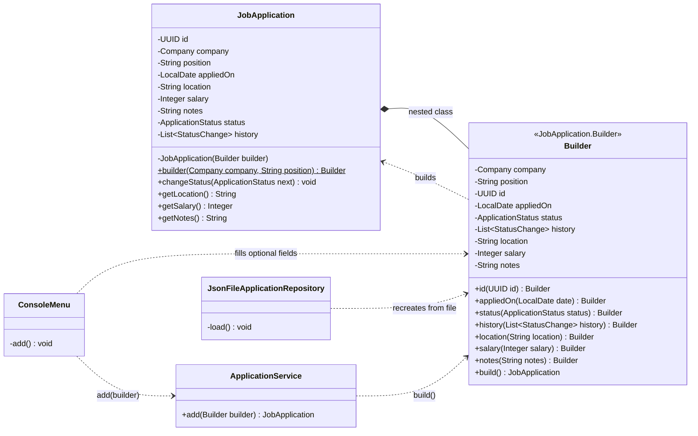
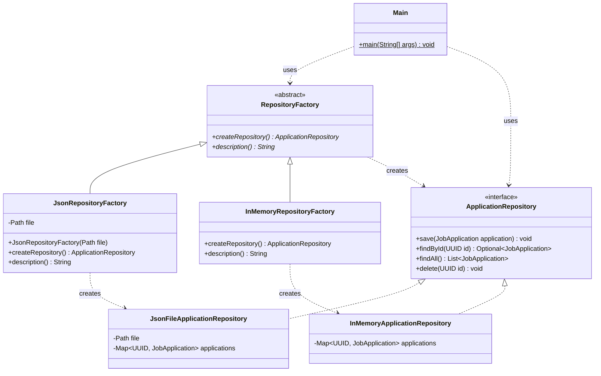
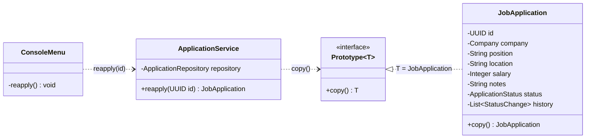

# Job Application Tracker

This project shows three creational design patterns in a simple console application for tracking job applications. It continues the application from Laboratory Work 1: you can still add the applications you sent, move them through statuses (Wishlist → Applied → Interview → Offer / Rejected / Withdrawn), filter them, view their status history, and keep them in a JSON file between runs. On top of that, the way objects are created now follows the Builder, Factory Method and Prototype patterns.

**Job Application Tracker - Creational Design Patterns Implementation**
Laboratory Work 2

## Table of Contents
- [Introduction](#introduction)
- [Features](#features)
- [Creational Patterns Applied](#creational-patterns-applied)
  - [Builder](#builder)
  - [Factory Method](#factory-method)
  - [Prototype](#prototype)
  - [Patterns Not Used](#patterns-not-used)
- [Project Structure](#project-structure)
  - [Directory Breakdown](#directory-breakdown)
- [Usage](#usage)
  - [Running the Application](#running-the-application)
  - [Example Output](#example-output)
- [Conclusion](#conclusion)
- [Author](#author)

## Introduction
The Job Application Tracker was built for Laboratory Work 1 to show SOLID principles. For Laboratory Work 2 the same application was extended with three of the five creational design patterns: Builder, Factory Method and Prototype. Creational patterns deal with how objects are created. They hide the details of construction, so the rest of the code does not depend on how, or from which concrete class, an object is made. Each pattern was chosen because it solves a real problem in the existing code instead of being added only for demonstration.

## Features
- **Add Applications**: Record the company and the position, plus an optional location, salary and notes.
- **Status Workflow**: Change an application's status. Only valid changes are allowed (for example, `APPLIED → INTERVIEW` works, `INTERVIEW → WISHLIST` does not).
- **Status History**: Every status change is saved with a timestamp.
- **Filtering**: Filter applications by status or by company (ignoring upper/lower case).
- **Short IDs**: Refer to an application by the first few characters of its ID (for example `59f3`).
- **Reapply**: Create a fresh copy of an existing application, for example to apply again to a job that rejected you.
- **Notifications**: A message is shown every time a status changes.
- **Persistence**: Applications are saved to `applications.json` with Jackson and loaded again on the next run. Files saved by Lab 1 still load.
- **Storage Selection**: Choose JSON or in-memory storage with a command-line argument, without changing any code.
- **Error Handling**: Invalid input (unknown ID, unknown status, forbidden status change, a salary that is not a number) shows an error message instead of crashing the program.

## Creational Patterns Applied

### Builder
- **Definition**: Builder separates the construction of a complex object from the object itself. A separate builder object collects the values step by step through chained methods, and a final `build()` call checks them and creates the object.
- **Problem in the Project**: In Lab 1, `JobApplication` had three constructors that called each other (the *telescoping constructor* problem). A call such as `new JobApplication(id, company, position, date, status, history)` is hard to read, and every new optional field (location, salary, notes) would have needed even more constructors.
- **Implementation in the Project**:
  - **JobApplication**: Its only constructor is private and takes a `Builder`, so the builder is the only way to create an application.
  - **JobApplication.Builder**: A static nested class. The required fields (company and position) are passed to `JobApplication.builder(...)`, so they cannot be forgotten. The optional fields have default values (a new random id, today's date, status `APPLIED`, empty history) or stay empty.
  - **build()**: Checks the values in one place (position not blank, salary not negative) before creating the object.
  - **Clients**: `ConsoleMenu` sets only the optional fields the user filled in, and `JsonFileApplicationRepository` uses the builder to recreate applications loaded from the file.



```java
// Builder: required fields go into builder(), optional fields are set only if the user entered them.
var builder = JobApplication.builder(company, askNonBlank("Position: "));
var location = ask("Location (optional): ");
if (!location.isEmpty()) builder.location(location);
var salary = ask("Salary (optional): ");
if (!salary.isEmpty()) builder.salary(parseSalary(salary));
var notes = ask("Notes (optional): ");
if (!notes.isEmpty()) builder.notes(notes);
var app = service.add(builder);
```

```java
// build() validates everything in one place before the object exists.
public JobApplication build() {
    if (company == null) throw new IllegalArgumentException("Company is required");
    if (position == null || position.isBlank()) throw new IllegalArgumentException("Position is required");
    if (id == null || appliedOn == null || status == null || history == null)
        throw new IllegalArgumentException("Id, date, status and history must not be null");
    if (salary != null && salary < 0) throw new IllegalArgumentException("Salary must not be negative");
    return new JobApplication(this);
}
```

```java
// The JSON repository rebuilds a stored application, including all of its saved state.
JobApplication toDomain() {
    return JobApplication.builder(new Company(company), position)
            .id(id)
            .appliedOn(appliedOn)
            .status(status)
            .history(history == null ? List.of() : history)
            .location(location)
            .salary(salary)
            .notes(notes)
            .build();
}
```

### Factory Method
- **Definition**: Factory Method defines an abstract method for creating an object in a *creator* class and lets subclasses (*concrete creators*) decide which concrete class to create. The client works only with the abstract creator and the product interface.
- **Problem in the Project**: In Lab 1, `Main` created `new JsonFileApplicationRepository(...)` directly. Switching to in-memory storage meant editing the code.
- **Implementation in the Project**:
  - **Product**: the `ApplicationRepository` interface.
  - **Concrete Products**: `JsonFileApplicationRepository` and `InMemoryApplicationRepository`.
  - **Creator**: the abstract class `RepositoryFactory`, with the factory method `createRepository()` and a `description()` of the storage.
  - **Concrete Creators**: `JsonRepositoryFactory` (knows the file path) and `InMemoryRepositoryFactory`.
  - **Client**: `Main` chooses a factory from the command-line argument once, then uses only `RepositoryFactory` and `ApplicationRepository`. Adding a new kind of storage (for example a database) means adding one new product and one new creator, without changing existing classes.
- **Difference from a "Simple Factory"**: a single method with a `switch` that returns different objects is a simple factory, not the Gang of Four pattern. In Factory Method, the creation is done by **subclasses that override** the factory method.



```java
// Creator: the factory method is abstract, so each subclass decides which repository is created.
public abstract class RepositoryFactory {
    public abstract ApplicationRepository createRepository();

    public abstract String description();
}
```

```java
// Concrete creator: knows how to make the JSON file repository.
public class JsonRepositoryFactory extends RepositoryFactory {
    private final Path file;

    public JsonRepositoryFactory(Path file) {
        this.file = file;
    }

    @Override
    public ApplicationRepository createRepository() {
        return new JsonFileApplicationRepository(file);
    }

    @Override
    public String description() {
        return "JSON file (" + file + ")";
    }
}
```

```java
// Client: after choosing the factory, Main never names a concrete repository class.
RepositoryFactory factory = args.length > 0 && args[0].equalsIgnoreCase("memory")
        ? new InMemoryRepositoryFactory()
        : new JsonRepositoryFactory(Path.of("applications.json"));
System.out.println("Storage: " + factory.description());

ApplicationRepository repository = factory.createRepository();
```

### Prototype
- **Definition**: Prototype creates new objects by copying an existing object (the *prototype*) instead of building them from scratch. The object itself knows how to copy itself, so the client does not need to know its class or its internal fields.
- **Problem in the Project**: When you are rejected and want to apply to the same job again later, you would have to type the company, position, location, salary and notes again.
- **Implementation in the Project**:
  - **Prototype Interface**: `Prototype<T>` declares a single method, `T copy()`. A custom interface is used instead of Java's `Cloneable`, which has well-known design problems (no `clone()` method in the interface, checked exceptions, shallow copies by default).
  - **Concrete Prototype**: `JobApplication` implements `Prototype<JobApplication>`. The copy keeps the job details (company, position, location, salary, notes) but gets a new identity and a fresh lifecycle: a new id, today's date, status `APPLIED` and an empty history.
  - **Client**: `ApplicationService.reapply()` copies the chosen application and saves the copy. It is available as option **8. Reapply** in the menu.
  - **Shallow vs. Deep Copy**: `Company`, `String`, `Integer` and `StatusChange` are immutable, so the copy can safely share them with the original. The only mutable field, the `history` list, is never shared: each application owns its own `ArrayList`, so changing the status of the copy never changes the original.
  - **Builder Reuse**: `copy()` is written with the builder, which shows how the two patterns work together.



```java
// Prototype interface: any object that can copy itself.
public interface Prototype<T> {
    T copy();
}
```

```java
// Concrete prototype: the same job details, with a new id, today's date, APPLIED status and empty history.
@Override
public JobApplication copy() {
    return builder(company, position)
            .location(location)
            .salary(salary)
            .notes(notes)
            .build();
}
```

```java
// Client: the service copies the existing application without knowing its fields.
public JobApplication reapply(UUID id) {
    var copy = get(id).copy();
    repository.save(copy);
    return copy;
}
```

### Patterns Not Used
- **Singleton**: A Singleton would make a single repository or service available globally. This creates hidden global state and goes against the Dependency Inversion Principle from Lab 1, where `ApplicationService` receives its dependencies through the constructor. One shared instance is already guaranteed by creating it once in `Main`.
- **Abstract Factory**: Abstract Factory creates *families* of related objects. The project currently has only one kind of product that varies (the repository), with a single notifier, so a family of products would have to be invented just to use the pattern. Factory Method solves the actual problem with less code.

## Project Structure

### Directory Breakdown
```bash
src/main/java/org/example/
├── Main.java                                   # Entry point, chooses the repository factory (Factory Method client)
├── Lab1/                                       # Laboratory Work 1 (SOLID), unchanged
└── Lab2/
    ├── ApplicationService.java                 # Use cases: add(builder), reapply(id) (Builder, Prototype client)
    ├── ApplicationPrinter.java                 # Console output, including the optional fields
    ├── ConsoleMenu.java                        # User interaction loop, fills the builder (Builder client)
    ├── domain/
    │   ├── JobApplication.java                 # Product with nested Builder; implements Prototype (Builder, Prototype)
    │   ├── Prototype.java                      # Prototype interface (Prototype)
    │   ├── ApplicationStatus.java              # Statuses and allowed changes
    │   ├── Company.java                        # Company value object (case-insensitive equality)
    │   └── StatusChange.java                   # One entry in the status history
    ├── filters/
    │   ├── ApplicationFilter.java              # Filter abstraction
    │   ├── StatusFilter.java                   # Filter by status
    │   └── CompanyFilter.java                  # Filter by company
    ├── notification/
    │   ├── Notifier.java                       # Notification abstraction
    │   └── ConsoleNotifier.java                # Prints notifications to the console
    └── repository/
        ├── ApplicationRepository.java          # Product interface (Factory Method)
        ├── InMemoryApplicationRepository.java  # Concrete product: stores applications in memory
        ├── JsonFileApplicationRepository.java  # Concrete product: stores applications in a JSON file (Jackson)
        ├── RepositoryFactory.java              # Abstract creator with the factory method (Factory Method)
        ├── JsonRepositoryFactory.java          # Concrete creator for JSON storage
        └── InMemoryRepositoryFactory.java      # Concrete creator for in-memory storage
pom.xml                                         # Project configuration and dependencies (Jackson)
```

## Usage

### Running the Application
Requires **Java 25** and **Maven**.

```bash
mvn compile
mvn exec:java -Dexec.mainClass=org.example.Main                      # JSON file storage (default)
mvn exec:java -Dexec.mainClass=org.example.Main -Dexec.args="memory" # in-memory storage
```

Or run `Main` directly from IntelliJ IDEA. To use in-memory storage there, write `memory` in *Run → Edit Configurations → Program arguments*.

Menu:
```
1. Add application
2. List all
3. Change status
4. Filter by status
5. Filter by company
6. Show status history
7. Delete
8. Reapply
0. Exit
```

### Example Output
```bash
Storage: JSON file (applications.json)

Company: Google
Position: Backend Dev
Location (optional): Remote
Salary (optional): 3000
Notes (optional): referral from Ana
Added:
59f3080d   Google          Backend Dev          APPLIED    2026-10-22
           Location: Remote | Salary: 3000 | Notes: referral from Ana

Company: Amazon
Position: SDE
Location (optional):
Salary (optional): abc
Error: Salary must be a whole number, got 'abc'

Id (first few characters): 59f3
Created a copy:
c14f3a53   Google          Backend Dev          APPLIED    2026-10-22
           Location: Remote | Salary: 3000 | Notes: referral from Ana

ID         COMPANY         POSITION             STATUS     APPLIED ON
8a03c86c   Endava          Junior Software Developer INTERVIEW  2026-10-15
59f3080d   Google          Backend Dev          APPLIED    2026-10-22
           Location: Remote | Salary: 3000 | Notes: referral from Ana
c14f3a53   Google          Backend Dev          APPLIED    2026-10-22
           Location: Remote | Salary: 3000 | Notes: referral from Ana
```

## Conclusion
The three creational patterns made object creation in the Job Application Tracker clearer and easier to extend. Builder replaced the telescoping constructors of `JobApplication`, made optional fields easy to add, and put all validation in one place. Factory Method removed the hard-coded repository from `Main`: the storage is now chosen at startup, and a new kind of storage can be added without changing existing classes. Prototype made it possible to reapply to a job by copying an existing application, while keeping the copy independent from the original. The patterns also work together: `copy()` and the JSON repository both create objects through the builder. Together with the SOLID principles from Lab 1, they keep the code easy to understand, extend and maintain.

## Author
**Temciuc Adelina FAF-242**
