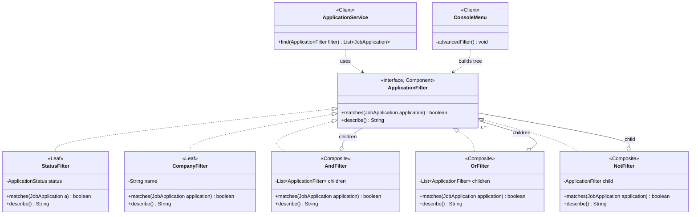
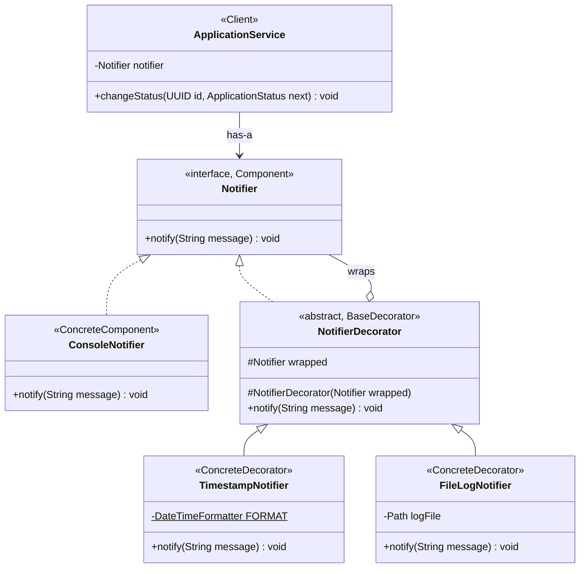
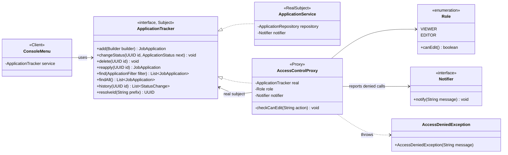
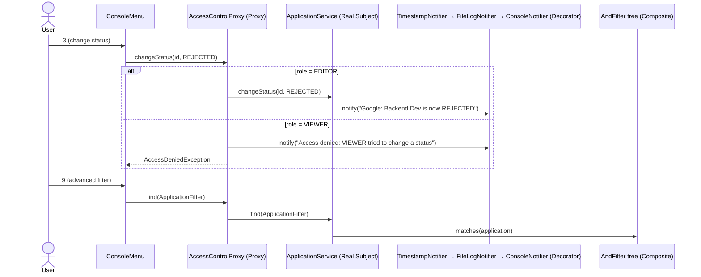

# Job Application Tracker

This project shows three structural design patterns in a simple console application for tracking job applications. It continues the application from Laboratory Works 1 and 2. You can still add the applications you sent, move them through statuses (Wishlist → Applied → Interview → Offer / Rejected / Withdrawn), filter them, view their status history, reapply, and keep them in a JSON file between runs. On top of that, the application now supports **advanced filters** (Composite), **stackable notifications** (Decorator) and a **read-only viewer mode** (Proxy).

**Job Application Tracker - Structural Design Patterns Implementation**
Laboratory Work 3

## Table of Contents
- [Introduction](#introduction)
- [Domain Description](#domain-description)
- [Features](#features)
- [Structural Patterns Applied](#structural-patterns-applied)
  - [Composite](#composite)
  - [Decorator](#decorator)
  - [Proxy](#proxy)
  - [How the Patterns Interact](#how-the-patterns-interact)
  - [Creational Patterns Reused from Lab 2](#creational-patterns-reused-from-lab-2)
  - [Patterns Not Used](#patterns-not-used)
- [Project Structure](#project-structure)
  - [Directory Breakdown](#directory-breakdown)
- [Usage](#usage)
  - [Running the Application](#running-the-application)
  - [Running the Tests](#running-the-tests)
  - [Example Output](#example-output)
- [Conclusions](#conclusions)
- [Author](#author)

## Introduction
The Job Application Tracker was built for Laboratory Work 1 to show the SOLID principles and extended in Laboratory Work 2 with the Builder, Factory Method and Prototype creational patterns. For Laboratory Work 3 the same application was extended with three of the seven structural design patterns: **Composite**, **Decorator** and **Proxy**. Structural patterns deal with how classes and objects are put together into larger structures, while keeping those structures flexible. Each pattern was chosen because it solves a real problem in the existing code instead of being added only for demonstration.

## Domain Description
The application helps a student who is looking for a job keep track of the applications they sent. Each application has a company, a position, a date and a status, plus an optional location, salary and notes. The user moves an application through its statuses, and every change is saved in its history. Applications can be searched with simple or combined filters. The tracker can also be opened in read-only mode, for example to show your applications to someone else, so nothing can be changed by mistake. Every important event (a status change, a blocked action) produces a notification. The notification is shown in the console with a timestamp and also written to `notifications.log`.

## Features
- **Add Applications**: Record the company and the position, plus an optional location, salary and notes (Builder, Lab 2).
- **Status Workflow**: Only valid status changes are allowed, and every change is saved with a timestamp.
- **Simple Filters**: Filter by status or by company.
- **Advanced Filter** *(new)*: Combine conditions, for example "status is APPLIED or INTERVIEW, the company is Google or Endava, and the status is not REJECTED" (Composite).
- **Stackable Notifications** *(new)*: Every notification gets a timestamp and is also appended to `notifications.log` (Decorator).
- **Read-Only Viewer Mode** *(new)*: Start the program with `viewer` to look at applications and filter them, while adding, changing, deleting and reapplying are blocked (Proxy).
- **Reapply**: Create a fresh copy of an existing application (Prototype, Lab 2).
- **Storage Selection**: JSON or in-memory storage, chosen with a command-line argument (Factory Method, Lab 2).

## Structural Patterns Applied

### Composite
- **Intent**: Treat individual objects and groups of objects in the same way through one interface.
- **Problem in the Project**: In Lab 2 there were only two filters, `StatusFilter` and `CompanyFilter`, and only one could be used at a time. To answer "show my APPLIED or INTERVIEW applications, but not those at Google", the menu would need a new method for every combination of conditions.
- **Implementation in the Project**:
  - **Component**: `ApplicationFilter` with `matches(JobApplication)` and `describe()`.
  - **Leaves**: `StatusFilter` and `CompanyFilter` check one condition.
  - **Composites**: `AndFilter` and `OrFilter` hold a list of child `ApplicationFilter`s, and `NotFilter` holds one child. The children can themselves be groups, so filters form a tree of any depth.
  - **Client**: `ApplicationService.find(ApplicationFilter)` and `ConsoleMenu.advancedFilter()`. The service never checks whether it received a leaf or a group, and there is no `instanceof` anywhere.

#### Class Diagram


#### Code Snippet
[`filters/AndFilter.java`](filters/AndFilter.java)
```java
// Composite: matches when every child filter matches. With no children it matches everything.
public class AndFilter implements ApplicationFilter {
    private final List<ApplicationFilter> children;

    public AndFilter(List<ApplicationFilter> children) {
        this.children = List.copyOf(children);
    }

    @Override
    public boolean matches(JobApplication application) {
        return children.stream().allMatch(f -> f.matches(application));
    }

    @Override
    public String describe() {
        if (children.isEmpty()) return "everything";
        if (children.size() == 1) return children.getFirst().describe();
        return children.stream().map(ApplicationFilter::describe)
                .collect(Collectors.joining(" AND ", "(", ")"));
    }
}
```
`AndFilter` is itself an `ApplicationFilter`, and its children are `ApplicationFilter`s as well. `matches()` just asks every child, which can be a leaf or another group, so the call goes down the whole tree on its own. The client builds the tree once and then calls one method on the root.

[`ConsoleMenu.java`](ConsoleMenu.java) builds the tree from the user's answers:
```java
var statuses = askList("Statuses (any of): ").stream()
        .map(s -> (ApplicationFilter) new StatusFilter(parseStatus(s))).toList();
if (!statuses.isEmpty()) parts.add(new OrFilter(statuses));
...
var excluded = askList("Exclude statuses: ").stream()
        .map(s -> (ApplicationFilter) new StatusFilter(parseStatus(s))).toList();
if (!excluded.isEmpty()) parts.add(new NotFilter(new OrFilter(excluded)));

var filter = new AndFilter(parts);
System.out.println("Filter: " + filter.describe());
printer.printAll(service.find(filter));
```

#### Unit Tests
[`src/test/java/org/example/Lab3/filters/CompositeFilterTest.java`](../../../../../test/java/org/example/Lab3/filters/CompositeFilterTest.java)

| Test | What it checks |
|------|----------------|
| `leafAndGroupAreUsedThroughTheSameInterface` | A leaf (`CompanyFilter`) and a group (`AndFilter` holding that leaf) are passed to the same client code as `ApplicationFilter` and give the same result. |
| `nestedGroupsCombineTheirChildren` | The tree `(APPLIED OR INTERVIEW) AND NOT Endava` returns the right application, and `describe()` prints the whole tree. |
| `emptyAndGroupMatchesEverything` | An `AndFilter` with no children matches every application (used when the user skips every question). |
| `newLeafCanBeAddedWithoutChangingExistingClasses` | A new filter written only in the test plugs into `NotFilter` without changing any existing class (open/closed). |

```
[INFO] Tests run: 4, Failures: 0, Errors: 0, Skipped: 0 -- in org.example.Lab3.filters.CompositeFilterTest
```

### Decorator
- **Intent**: Add responsibilities to an object at runtime by wrapping it, in any combination.
- **Problem in the Project**: In Lab 2 the only notifier was `ConsoleNotifier`, which printed the message. We also wanted a timestamp on every message and a copy of every message in a log file. Subclasses such as `TimestampedConsoleNotifier`, `LoggingConsoleNotifier` and `TimestampedLoggingConsoleNotifier` would multiply with every new feature, and they could not be combined at runtime.
- **Implementation in the Project**:
  - **Component**: the `Notifier` interface with `notify(String)`.
  - **Concrete Component**: `ConsoleNotifier` prints the message.
  - **Base Decorator**: the abstract `NotifierDecorator`. It implements `Notifier`, holds the wrapped `Notifier` and by default only passes the message on.
  - **Concrete Decorators**: `TimestampNotifier` adds the date and time in front of the message. `FileLogNotifier` also appends the message to a file.
  - **Client**: `ApplicationService` receives a `Notifier` in its constructor and does not know how many decorators wrap it. The chain is built in `Main`.

#### Class Diagram


#### Code Snippet
[`notification/NotifierDecorator.java`](notification/NotifierDecorator.java), [`notification/TimestampNotifier.java`](notification/TimestampNotifier.java), [`notification/FileLogNotifier.java`](notification/FileLogNotifier.java)
```java
public abstract class NotifierDecorator implements Notifier {
    protected final Notifier wrapped;

    protected NotifierDecorator(Notifier wrapped) {
        if (wrapped == null) throw new IllegalArgumentException("Wrapped notifier must not be null");
        this.wrapped = wrapped;
    }

    @Override
    public void notify(String message) {
        wrapped.notify(message);
    }
}

public class TimestampNotifier extends NotifierDecorator {
    @Override
    public void notify(String message) {
        super.notify("[" + LocalDateTime.now().format(FORMAT) + "] " + message);
    }
}

public class FileLogNotifier extends NotifierDecorator {
    @Override
    public void notify(String message) {
        super.notify(message);
        Files.writeString(logFile, message + System.lineSeparator(), CREATE, APPEND);
    }
}
```
[`Main.java`](../Main.java) builds the chain:
```java
Notifier notifier = new TimestampNotifier(
        new FileLogNotifier(new ConsoleNotifier(), Path.of("notifications.log")));
var service = new ApplicationService(repository, notifier);
```
Every decorator is a `Notifier` and also holds a `Notifier`, so it can wrap the real notifier or another decorator. Each decorator does its own small job and then calls `super.notify(...)`, which passes the message to the next object in the chain. Because the timestamp decorator is outside, both the log file and the console receive the timestamped message.

#### Unit Tests
[`src/test/java/org/example/Lab3/notification/NotifierDecoratorTest.java`](../../../../../test/java/org/example/Lab3/notification/NotifierDecoratorTest.java). A `RecordingNotifier` stub is used as the concrete component, so the tests can check the messages without reading the console.

| Test | What it checks |
|------|----------------|
| `timestampDecoratorAddsTimeAndPassesMessageOn` | The wrapped notifier receives the message once, with a `[yyyy-MM-dd HH:mm:ss]` prefix. |
| `decoratorsStackedInAnyOrderStillDeliverTimestampedMessageAndLogIt` | `Timestamp(FileLog(x))` and `FileLog(Timestamp(x))` both deliver a timestamped message and both write the log. The order only decides whether the log line contains the timestamp. |
| `sameDecoratorCanBeUsedTwice` | The same decorator can wrap itself (two `FileLogNotifier`s write two lines), which a subclass could not do. |
| `decoratorRejectsMissingWrappedNotifier` | A decorator cannot be created without something to wrap. |

```
[INFO] Tests run: 4, Failures: 0, Errors: 0, Skipped: 0 -- in org.example.Lab3.notification.NotifierDecoratorTest
```

### Proxy
- **Intent**: Control access to an object through a stand-in that has the same interface.
- **Problem in the Project**: Sometimes you want to show your applications to someone else (a friend, a career advisor) or just browse them, without any risk of changing or deleting something by mistake. Putting `if (readOnly)` checks inside every method of `ApplicationService` would mix access rules with business logic and break the Single Responsibility Principle from Lab 1. Putting them in `ConsoleMenu` would be easy to forget when a new menu option is added.
- **Implementation in the Project**:
  - **Subject**: the `ApplicationTracker` interface with all the use cases (`add`, `changeStatus`, `delete`, `reapply`, `find`, `findAll`, `history`, `resolveId`).
  - **Real Subject**: `ApplicationService` does the actual work and knows nothing about roles.
  - **Proxy**: `AccessControlProxy` implements `ApplicationTracker` and holds the real `ApplicationTracker`, the current `Role` and a `Notifier`. Reading methods are passed on unchanged. Changing methods first check the role. A `VIEWER` is stopped with an `AccessDeniedException` before the call reaches the real service, and the attempt is reported through the notifier.
  - **Client**: `ConsoleMenu` depends only on `ApplicationTracker`. `Main` decides whether the menu gets the proxy in front of the service: run the program with the argument `viewer` to open it read-only.
- **Why the proxy is in front of the service and not the repository**: `ApplicationService.changeStatus` changes the `JobApplication` object first and saves it afterwards. A proxy around the repository would only stop the save, after the status in memory was already changed. The proxy in front of the service stops the call before anything happens.

#### Class Diagram


#### Code Snippet
[`access/AccessControlProxy.java`](access/AccessControlProxy.java)
```java
public class AccessControlProxy implements ApplicationTracker {
    private final ApplicationTracker real;
    private final Role role;
    private final Notifier notifier;

    private void checkCanEdit(String action) {
        if (!role.canEdit()) {
            notifier.notify("Access denied: " + role + " tried to " + action);
            throw new AccessDeniedException("A " + role + " cannot " + action);
        }
    }

    @Override
    public void changeStatus(UUID id, ApplicationStatus next) {
        checkCanEdit("change a status");      // checked first...
        real.changeStatus(id, next);          // ...then passed on to the real service
    }

    @Override
    public List<JobApplication> find(ApplicationFilter filter) {
        return real.find(filter);             // reading: passed on unchanged
    }
    // add, delete and reapply are checked the same way; findAll, history and resolveId are passed on.
}
```
The proxy implements the same `ApplicationTracker` interface as the real service, so the menu cannot tell them apart. Every changing method calls `checkCanEdit` before delegating, so a denied call never reaches `ApplicationService`. Allowed calls are forwarded with the same arguments, and their results are returned unchanged.

[`Main.java`](../Main.java) puts the proxy in front of the real service:
```java
Role role = options.contains("viewer") ? Role.VIEWER : Role.EDITOR;
ApplicationTracker service = new ApplicationService(repository, notifier);
ApplicationTracker tracker = new AccessControlProxy(service, role, notifier);
new ConsoleMenu(tracker, new ApplicationPrinter()).run();
```

#### Unit Tests
[`src/test/java/org/example/Lab3/access/AccessControlProxyTest.java`](../../../../../test/java/org/example/Lab3/access/AccessControlProxyTest.java). Each test creates a real `ApplicationService` with in-memory storage and puts a proxy in front of it.

| Test | What it checks |
|------|----------------|
| `viewerIsBlockedFromEveryChangeAndRealObjectStaysUntouched` | For a `VIEWER`, `add`, `changeStatus`, `delete` and `reapply` all throw `AccessDeniedException`. The real service still holds the same single application with its old status, and each attempt was reported. |
| `viewerCanStillReadAndGetsSameResultsAsRealService` | For a `VIEWER`, `findAll`, `find`, `resolveId` and `history` return exactly what the real service returns, and nothing is reported. |
| `editorCallsArePassedThroughUnchanged` | For an `EDITOR`, `changeStatus` and `reapply` reach the real service and change its data exactly as a direct call would. |

```
[INFO] Tests run: 3, Failures: 0, Errors: 0, Skipped: 0 -- in org.example.Lab3.access.AccessControlProxyTest
```

### How the Patterns Interact
The patterns are not isolated demos. They all sit on the same path that every menu action takes:



- **Proxy → Decorator**: both the real service and the proxy report through the same `Notifier`, which is the Decorator chain built in `Main`. A denied action is timestamped and written to `notifications.log` just like a status change.
- **Proxy → Composite**: `find(ApplicationFilter)` passes through the proxy unchanged, so a viewer can still build any filter tree.
- **Factory Method → Proxy**: the repository behind the real service is still created by the `RepositoryFactory` from Lab 2.

Every class depends only on abstractions: `ConsoleMenu` knows `ApplicationTracker`, `AccessControlProxy` knows `ApplicationTracker` and `Notifier`, and `ApplicationService` knows `ApplicationRepository`, `Notifier` and `ApplicationFilter`.

[`src/test/java/org/example/Lab3/PatternInteractionTest.java`](../../../../../test/java/org/example/Lab3/PatternInteractionTest.java) uses the same wiring as `Main`:

| Test | What it checks |
|------|----------------|
| `editorChangeGoesThroughProxyAndIsReportedByDecorators` | An editor's status change passes through the proxy to the service. The notification arrives timestamped and is also in the log file (Decorator). A Composite `NOT status = REJECTED` filter then returns only the active application. |
| `viewerIsDeniedThroughDecoratorsButCanStillUseCompositeFilters` | A viewer's `delete` is stopped by the proxy, and the denial goes through the Decorator chain into the log. A Composite `company = Google AND status = APPLIED` filter still works through the proxy. |

```
[INFO] Tests run: 2, Failures: 0, Errors: 0, Skipped: 0 -- in org.example.Lab3.PatternInteractionTest
```

**Open for extension**: each pattern can get a new variant by adding a class only:
- a new filter (for example `SalaryAboveFilter`) implements `ApplicationFilter` and works inside any `AndFilter`/`OrFilter`/`NotFilter`;
- a new decorator (for example `UpperCaseNotifier` or `EmailNotifier`) extends `NotifierDecorator` and is added to the chain in `Main`;
- a new proxy (for example a `LoggingTrackerProxy` that measures how long each call takes) implements `ApplicationTracker`, and it can even wrap `AccessControlProxy` because both have the same interface.

### Creational Patterns Reused from Lab 2
- **Builder**: `add` still receives a `JobApplication.Builder`, both through the proxy and directly.
- **Factory Method**: `Main` still chooses the repository through `RepositoryFactory`, and the tests use `InMemoryRepositoryFactory` to get a repository without a file.
- **Prototype**: the *Reapply* option still copies an application with `copy()`, and it is now protected by the proxy.

### Patterns Not Used
- **Adapter**: the application does not use any outside library or format whose interface does not fit. Adapting a class written for this project would not show a real incompatibility.
- **Facade**: `ApplicationService` already gives the menu one simple entry point, and the subsystems behind it are small. A separate facade would only forward the same calls.
- **Bridge**: no part of the project has two dimensions that change independently. A bridge with one implementation on one side would not bridge anything.
- **Flyweight**: the application keeps a few dozen applications, so there is no memory problem to solve with shared state.

## Project Structure

### Directory Breakdown
```bash
src/main/java/org/example/
├── Main.java                                   # Entry point: chooses storage and role, builds the decorator chain and the proxy
├── Lab1/                                       # Laboratory Work 1 (SOLID), unchanged
├── Lab2/                                       # Laboratory Work 2 (creational patterns), unchanged
└── Lab3/
    ├── README.md                               # Build, run and test instructions
    ├── REPORT.md                               # This report
    ├── ApplicationTracker.java                 # Subject interface (Proxy)
    ├── ApplicationService.java                 # Real subject (Proxy); client of Composite and Decorator
    ├── ApplicationPrinter.java                 # Console output
    ├── ConsoleMenu.java                        # User interaction loop; builds filter trees; knows only ApplicationTracker
    ├── access/                                 # Proxy
    │   ├── AccessControlProxy.java             # Proxy
    │   ├── Role.java                           # VIEWER / EDITOR
    │   └── AccessDeniedException.java          # Thrown when a role may not do something
    ├── domain/                                 # Domain models (JobApplication + Builder, Prototype, Company, ...)
    ├── filters/                                # Composite
    │   ├── ApplicationFilter.java              # Component
    │   ├── StatusFilter.java                   # Leaf
    │   ├── CompanyFilter.java                  # Leaf
    │   ├── AndFilter.java                      # Composite
    │   ├── OrFilter.java                       # Composite
    │   └── NotFilter.java                      # Composite (one child)
    ├── notification/                           # Decorator
    │   ├── Notifier.java                       # Component
    │   ├── ConsoleNotifier.java                # Concrete component
    │   ├── NotifierDecorator.java              # Base decorator
    │   ├── TimestampNotifier.java              # Concrete decorator
    │   └── FileLogNotifier.java                # Concrete decorator
    └── repository/                             # Factory Method from Lab 2 (JSON / in-memory)

src/test/java/org/example/Lab3/
├── PatternInteractionTest.java                 # Proxy + Decorator + Composite in one flow
├── access/AccessControlProxyTest.java
├── filters/CompositeFilterTest.java
└── notification/NotifierDecoratorTest.java
```

## Usage

### Running the Application
Requires **Java 25** and **Maven**.

```bash
mvn compile
mvn exec:java -Dexec.mainClass=org.example.Main                             # JSON storage, editor
mvn exec:java -Dexec.mainClass=org.example.Main -Dexec.args="memory"        # in-memory storage, editor
mvn exec:java -Dexec.mainClass=org.example.Main -Dexec.args="viewer"        # JSON storage, read-only
mvn exec:java -Dexec.mainClass=org.example.Main -Dexec.args="memory viewer" # in-memory storage, read-only
```

Menu:
```
1. Add application
2. List all
3. Change status
4. Filter by status
5. Filter by company
6. Show status history
7. Delete
8. Reapply
9. Advanced filter
0. Exit
```

### Running the Tests
```bash
mvn test
```

```
[INFO] -------------------------------------------------------
[INFO]  T E S T S
[INFO] -------------------------------------------------------
[INFO] Tests run: 4, Failures: 0, Errors: 0, Skipped: 0 -- in org.example.Lab3.filters.CompositeFilterTest
[INFO] Tests run: 4, Failures: 0, Errors: 0, Skipped: 0 -- in org.example.Lab3.notification.NotifierDecoratorTest
[INFO] Tests run: 2, Failures: 0, Errors: 0, Skipped: 0 -- in org.example.Lab3.PatternInteractionTest
[INFO] Tests run: 3, Failures: 0, Errors: 0, Skipped: 0 -- in org.example.Lab3.access.AccessControlProxyTest
[INFO]
[INFO] Tests run: 13, Failures: 0, Errors: 0, Skipped: 0
[INFO] BUILD SUCCESS
```

### Example Output
Started with `viewer`: listing works, but changing and deleting are blocked by the proxy, and every attempt goes through the decorators (timestamp + log file):
```
Storage: JSON file (applications.json)
Role: VIEWER

2
ID         COMPANY         POSITION             STATUS     APPLIED ON
8a03c86c   Endava          Junior Software Developer REJECTED   2026-10-15
c7d0f0e6   Endava          Junior Software Developer APPLIED    2026-10-29
792fff5a   Endava          Junior Software Developer APPLIED    2026-10-29
2f3f5081   Noction         Junior Full-Stack Developer INTERVIEW  2026-11-12

3
Id (first few characters): 8a03
Status [WISHLIST, APPLIED, INTERVIEW, OFFER, REJECTED, WITHDRAWN]: INTERVIEW
[notification] [2026-11-19 12:05:29] Access denied: VIEWER tried to change a status
Error: A VIEWER cannot change a status

7
Id (first few characters): 8a03
[notification] [2026-11-19 12:05:29] Access denied: VIEWER tried to delete an application
Error: A VIEWER cannot delete an application
```

Started without `viewer` (editor), the same actions are passed on to the real service:
```
Storage: in memory (data is lost on exit)
Role: EDITOR

1
Company: Google
Position: Backend Dev
Location (optional): Remote
Salary (optional): 3000
Notes (optional):
Added:
25177f35   Google          Backend Dev          APPLIED    2026-11-19
           Location: Remote | Salary: 3000
```

## Conclusions
The three structural patterns made the Job Application Tracker more flexible without changing what it already did. Composite turned two fixed filters into a small filter language: any combination of AND, OR and NOT can be built from the same few classes, and the service still calls one method. Decorator let us add timestamps and file logging to notifications without touching `ConsoleNotifier` or `ApplicationService`, and the features can be combined in any order. Proxy added a read-only mode without one `if` inside the service or the menu: access rules live in one class, and the menu cannot tell whether it talks to the proxy or to the real service.

**What was harder than expected**: with Decorator, the order of the wrappers matters more than it first seems. Putting `TimestampNotifier` outside `FileLogNotifier` puts the timestamp in the log, and the other way round does not, so the order in `Main` had to be chosen on purpose. With Proxy, the first idea was to protect the repository, but `changeStatus` changes the object before saving it, so a repository proxy would block the save too late. The proxy had to stand in front of the service instead, which meant first extracting the `ApplicationTracker` interface.

**What I would design differently**: `NotFilter` and `OrFilter` could be created through small factory methods (for example `ApplicationFilter.not(...)`) to make the menu code shorter. The menu still asks a viewer for all the details of a new application before the proxy says no. A `canEdit()` method on the subject would let the menu hide those options instead. Finally, the role is chosen once at startup. A real application would have a login, and the proxy would read the role from the current user session.

## Author
**Temciuc Adelina FAF-242**
