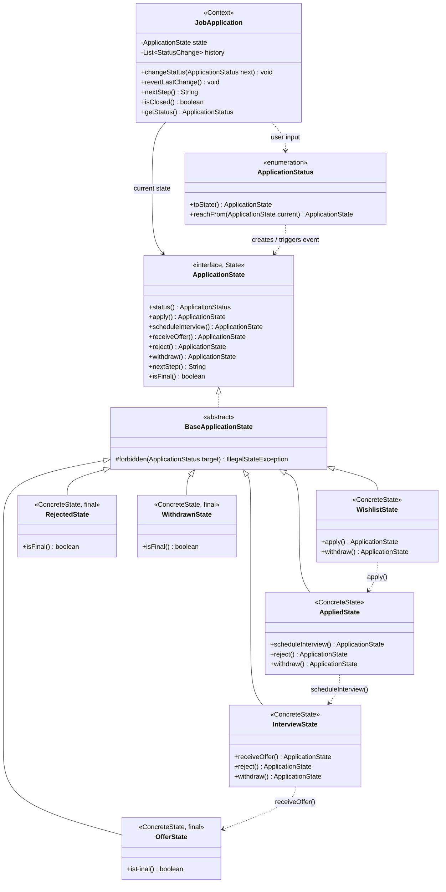
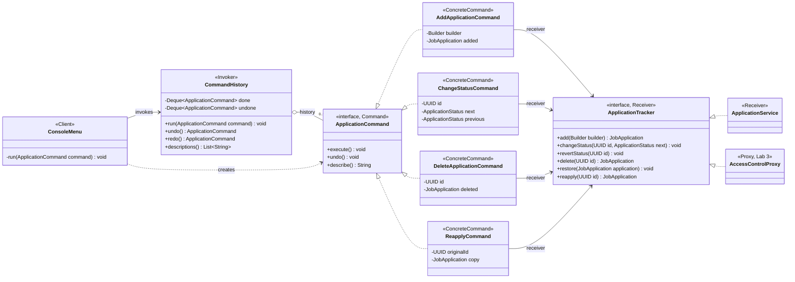
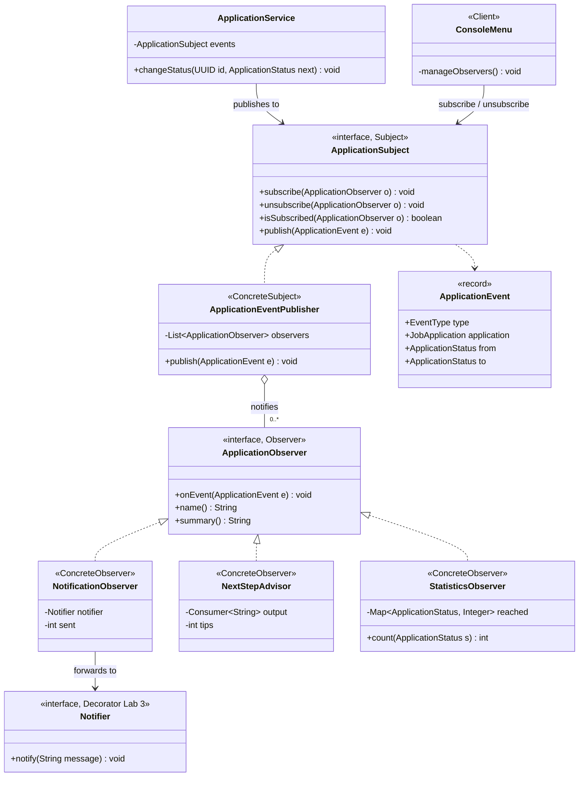
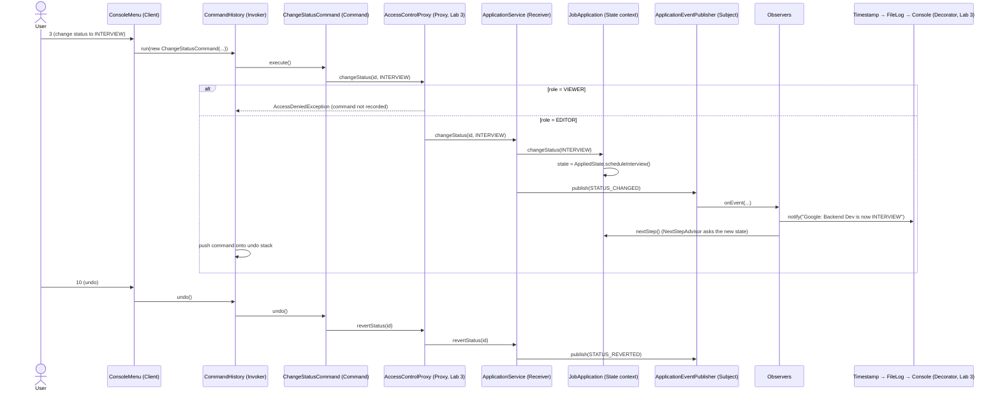

# Job Application Tracker

This project shows three behavioral design patterns in a simple console application for tracking job applications. It continues the application from Laboratory Works 1, 2 and 3. You can still add the applications you sent, move them through statuses (Wishlist → Applied → Interview → Offer / Rejected / Withdrawn), filter them with simple or combined filters, open the tracker read-only and keep everything in a JSON file between runs. On top of that, the status workflow is now made of **state objects** (State), every change can be **undone and redone** (Command), and every change is **announced to subscribers** that you can turn on and off while the program runs (Observer).

**Job Application Tracker - Behavioral Design Patterns Implementation**
Laboratory Work 4

## Table of Contents
- [Introduction](#introduction)
- [Domain Description](#domain-description)
- [Features](#features)
- [Behavioral Patterns Applied](#behavioral-patterns-applied)
  - [State](#state)
  - [Command](#command)
  - [Observer](#observer)
  - [How the Patterns Interact](#how-the-patterns-interact)
  - [Open for Extension](#open-for-extension)
  - [Patterns Reused from Labs 2 and 3](#patterns-reused-from-labs-2-and-3)
  - [Patterns Not Used](#patterns-not-used)
- [Project Structure](#project-structure)
  - [Directory Breakdown](#directory-breakdown)
- [Usage](#usage)
  - [Running the Application](#running-the-application)
  - [Running the Tests](#running-the-tests)
  - [Example Output](#example-output)
- [Conclusions](#conclusions)
- [Author](#author)

## Introduction
The Job Application Tracker was built for Laboratory Work 1 to show the SOLID principles. It was extended in Laboratory Work 2 with the Builder, Factory Method and Prototype creational patterns, and in Laboratory Work 3 with the Composite, Decorator and Proxy structural patterns. For Laboratory Work 4 the same application was extended with three behavioral design patterns: **State**, **Command** and **Observer**. Behavioral patterns deal with how objects share responsibilities and communicate. Each pattern was chosen because it solves a real problem in the existing code: a `switch` that held every status rule, changes that could not be taken back, and a service that was tied to a single way of reporting what happened.

## Domain Description
The application helps a student who is looking for a job keep track of the applications they sent. Each application has a company, a position, a date and a status, plus an optional location, salary and notes. An application goes through a fixed workflow: it can be on the wishlist, applied, at the interview stage, or closed with an offer, a rejection or a withdrawal. Every status has its own rules about where it can go next and its own advice about what to do next. Every change the user makes (adding, changing the status, deleting, reapplying) is recorded, so it can be undone and redone. Every change is also published as an event. A notifier shows it in the console with a timestamp and writes it to `notifications.log`, an advisor prints the next step, and a statistics counter tracks the session. The user can turn each of these on or off at runtime.

## Features
- **Add Applications**: Record the company and the position, plus an optional location, salary and notes (Builder, Lab 2).
- **Status Workflow** *(reworked)*: Each status is a state object that decides which changes are allowed and suggests the next step (State).
- **Undo / Redo** *(new)*: Adding, changing a status, deleting and reapplying can all be undone and redone. A deleted application comes back with its full history (Command).
- **Command History** *(new)*: Shows the actions that can be undone, newest first (Command).
- **Live Observers** *(new)*: Notifications, a next-step advisor and session statistics react to every change, and each one can be subscribed or unsubscribed from the menu while the program runs (Observer).
- **Simple and Advanced Filters**: Filter by status or company, or combine conditions with AND / OR / NOT (Composite, Lab 3).
- **Stackable Notifications**: Every notification gets a timestamp and is also appended to `notifications.log` (Decorator, Lab 3).
- **Read-Only Viewer Mode**: Start the program with `viewer` to block every change, including undo and redo (Proxy, Lab 3).
- **Reapply**: Create a fresh copy of an existing application (Prototype, Lab 2).
- **Storage Selection**: JSON or in-memory storage, chosen with a command-line argument (Factory Method, Lab 2).

## Behavioral Patterns Applied

### State
- **Intent**: Change an object's behavior when its internal state changes. To the client, it looks as if the object changed its class.
- **Problem in the Project**: In Lab 3 every status rule lived in one `switch` inside `ApplicationStatus.canMoveTo()`, and `JobApplication` checked that `switch` before changing a plain enum field. Every new rule or status-specific behavior (for example "what should I do next?") meant another `switch` on the same enum, spread across the code. This is the "switch on a state enum inside the context" mistake the pattern is meant to remove.
- **Implementation in the Project**:
  - **State interface**: `ApplicationState` has one method per event in an application's life (`apply`, `scheduleInterview`, `receiveOffer`, `reject`, `withdraw`), plus `status()`, `nextStep()` and `isFinal()`.
  - **Base state**: the abstract `BaseApplicationState` forbids every event by default, with the message `"APPLIED -> OFFER not allowed"`.
  - **Concrete states**: `WishlistState`, `AppliedState`, `InterviewState`, `OfferState`, `RejectedState` and `WithdrawnState`. Each overrides only the events it allows and returns the next state object, so each status's transitions sit in one small class. `OfferState`, `RejectedState` and `WithdrawnState` are final states.
  - **Context**: `JobApplication` holds an `ApplicationState` and delegates `changeStatus`, `nextStep()` and `isClosed()` to it.
  - `ApplicationStatus` is now only a label, used for storage, filters and user input. Each constant knows its state class and the event that leads to it (`INTERVIEW(InterviewState::new, ApplicationState::scheduleInterview)`), so there is no `switch` left.

#### Class Diagram


#### Code Snippet
[`domain/JobApplication.java`](domain/JobApplication.java), [`domain/state/AppliedState.java`](domain/state/AppliedState.java), [`domain/state/BaseApplicationState.java`](domain/state/BaseApplicationState.java)
```java
// Context: delegates to its current state
public void changeStatus(ApplicationStatus next){
    var from = state.status();
    state = next.reachFrom(state);         // e.g. INTERVIEW -> state.scheduleInterview()
    history.add(new StatusChange(from, state.status(), LocalDateTime.now()));
}

// Base state: every event is forbidden unless a concrete state overrides it
public abstract class BaseApplicationState implements ApplicationState {
    @Override
    public ApplicationState receiveOffer() {
        throw forbidden(ApplicationStatus.OFFER);
    }
    // apply, scheduleInterview, reject and withdraw look the same
}

// Concrete state: allows exactly three events and decides the next state itself
public class AppliedState extends BaseApplicationState {
    public ApplicationState scheduleInterview() { return new InterviewState(); }
    public ApplicationState reject()            { return new RejectedState(); }
    public ApplicationState withdraw()          { return new WithdrawnState(); }
    public String nextStep() { return "Wait for an answer; follow up if there is no reply in a week."; }
}
```
`JobApplication` never checks which status it is in. It hands the event to its current state object and stores whatever state comes back. If the state does not allow the event, the inherited method throws before `state` or `history` change, so a forbidden transition leaves the application untouched. Behavior that depends on the status, like `nextStep()`, is answered by the state object as well.

#### Unit Tests
[`src/test/java/org/example/Lab4/domain/state/ApplicationStateTest.java`](../../../../../test/java/org/example/Lab4/domain/state/ApplicationStateTest.java)

| Test | What it checks |
|------|----------------|
| `validTransitionsMoveThroughTheWholeWorkflow` | WISHLIST → APPLIED → INTERVIEW → OFFER is allowed, the application ends closed, and every step is in the history. |
| `forbiddenTransitionIsRejectedAndStateStaysTheSame` | APPLIED → OFFER throws `"APPLIED -> OFFER not allowed"`, and the status and history are unchanged. |
| `finalStatesAcceptNoEvents` | `OfferState`, `RejectedState` and `WithdrawnState` are final and reject all five events. |
| `behaviourChangesWithTheState` | After APPLIED → INTERVIEW, `nextStep()` gives the advice of `InterviewState`, not `AppliedState`. |
| `nobodyCanGoBackToWishlist` | No state can return to WISHLIST. |

```
[INFO] Tests run: 5, Failures: 0, Errors: 0, Skipped: 0 -- in org.example.Lab4.domain.state.ApplicationStateTest
```

### Command
- **Intent**: Turn a request into an object, so it can be stored, undone and redone.
- **Problem in the Project**: In Lab 3 a mistake could not be taken back. A wrong status (choosing REJECTED instead of INTERVIEW) stayed forever, because the workflow does not allow going back, and a deleted application was simply gone. The menu called the service directly, so there was nowhere to remember what had been done.
- **Implementation in the Project**:
  - **Command interface**: `ApplicationCommand` with `execute()`, `undo()` and `describe()`.
  - **Concrete commands**: `AddApplicationCommand`, `ChangeStatusCommand`, `DeleteApplicationCommand` and `ReapplyCommand`. Each one stores only what it needs to reverse itself: the id, the deleted object or the created copy. The commands hold no business logic; they call the receiver.
  - **Receiver**: `ApplicationTracker` (`ApplicationService`, possibly behind the Lab 3 proxy). It got two new receiver methods for undo: `revertStatus(id)` and `restore(application)`. `delete(id)` now returns the removed application.
  - **Invoker**: `CommandHistory` runs commands and keeps an undo stack and a redo stack. A command that throws is not recorded, and a new command clears the redo stack.
  - **Client**: `ConsoleMenu` creates a command for every change and passes it to `CommandHistory.run()`. Options 10, 11 and 12 are undo, redo and show history.

#### Class Diagram


#### Code Snippet
[`commands/CommandHistory.java`](commands/CommandHistory.java), [`commands/ChangeStatusCommand.java`](commands/ChangeStatusCommand.java)
```java
public class CommandHistory {
    private final Deque<ApplicationCommand> done = new ArrayDeque<>();
    private final Deque<ApplicationCommand> undone = new ArrayDeque<>();

    // If execute() throws (forbidden transition, viewer role, ...) nothing is recorded.
    public void run(ApplicationCommand command) {
        command.execute();
        done.push(command);
        undone.clear();
    }

    public ApplicationCommand undo() {
        if (done.isEmpty()) throw new IllegalStateException("Nothing to undo");
        var command = done.peek();
        command.undo();
        undone.push(done.pop());
        return command;
    }
}

public class ChangeStatusCommand implements ApplicationCommand {
    public void execute() {
        var app = tracker.get(id);
        previous = app.getStatus();
        title = app.getCompany() + ": " + app.getPosition();
        tracker.changeStatus(id, next);   // the receiver (and its State) does the work
    }

    public void undo() {
        tracker.revertStatus(id);         // the receiver knows how to go back
    }
}
```
`CommandHistory` only knows `execute()` and `undo()`, so it can store, undo and redo any command without knowing what it does. The command only calls the receiver, so the business rules stay in `ApplicationService` and `JobApplication`. A command is pushed only after `execute()` returns, so a failed action never appears in the history and can never be "undone".

#### Unit Tests
[`src/test/java/org/example/Lab4/commands/CommandHistoryTest.java`](../../../../../test/java/org/example/Lab4/commands/CommandHistoryTest.java). Each test uses a real `ApplicationService` with in-memory storage.

| Test | What it checks |
|------|----------------|
| `executeThenUndoRestoresTheOriginalStatus` | Changing APPLIED → INTERVIEW and then undoing gives back APPLIED with an empty history. |
| `redoRunsTheUndoneCommandAgain` | After undo, redo moves the application to INTERVIEW again, and the redo stack is empty. |
| `undoDeleteBringsBackTheSameApplicationWithItsHistory` | A deleted application comes back with the same id, status and history. |
| `undoAddAndRedoKeepTheSameId` | Undoing an add removes the application; redo puts back the same object, not a new one. |
| `failedCommandIsNotRecorded` | A forbidden transition (APPLIED → OFFER) throws, and nothing can be undone afterwards. |
| `newCommandClearsRedoAndHistoryIsNewestFirst` | Running a new command after an undo clears redo; the history lists only the last command. |
| `anyNewCommandWorksWithTheInvokerWithoutChangingIt` | A command written only in the test is executed and undone by `CommandHistory` without changing it (open/closed). |

```
[INFO] Tests run: 7, Failures: 0, Errors: 0, Skipped: 0 -- in org.example.Lab4.commands.CommandHistoryTest
```

### Observer
- **Intent**: When one object changes, notify all the objects that depend on it, without the first object knowing who they are.
- **Problem in the Project**: In Lab 3 `ApplicationService` held a `Notifier` and called it by hand inside `changeStatus`. Adding a new reaction to a change (statistics, advice for the next step) meant editing the service every time, and the user could not turn a reaction off without restarting the program. Additions and deletions were not reported at all.
- **Implementation in the Project**:
  - **Subject interface**: `ApplicationSubject` with `subscribe`, `unsubscribe`, `isSubscribed` and `publish`.
  - **Concrete subject**: `ApplicationEventPublisher` keeps the list of observers and notifies a copy of it, so an observer can unsubscribe while it is being notified.
  - **Observer interface**: `ApplicationObserver` with `onEvent(ApplicationEvent)`, plus `name()` and `summary()` for the menu.
  - **Concrete observers**:
    - `NotificationObserver` turns the event into a message and sends it through the Lab 3 Decorator chain (timestamp + log file + console).
    - `NextStepAdvisor` asks the application's new **State** for `nextStep()` after every status change.
    - `StatisticsObserver` counts how many applications reached each status in this session, and decreases the count when a change is undone.
  - **Event**: the `ApplicationEvent` record (`EventType` ADDED, STATUS_CHANGED, STATUS_REVERTED, DELETED, RESTORED, plus the application and from/to status).
  - **Publisher of events**: `ApplicationService` publishes after every change and knows only `ApplicationSubject`.
  - **Runtime change**: menu option 13 lists the observers with `[on]` / `[off]` and subscribes or unsubscribes the one you pick.
- **No update loops**: observers only read the event. None of them calls the service back, so a notification can never cause another change.

#### Class Diagram


#### Code Snippet
[`events/ApplicationEventPublisher.java`](events/ApplicationEventPublisher.java), [`ApplicationService.java`](ApplicationService.java)
```java
public class ApplicationEventPublisher implements ApplicationSubject {
    private final List<ApplicationObserver> observers = new ArrayList<>();

    public void subscribe(ApplicationObserver observer) {
        if (observer == null) throw new IllegalArgumentException("Observer must not be null");
        if (!observers.contains(observer)) observers.add(observer);
    }

    public void unsubscribe(ApplicationObserver observer) {
        observers.remove(observer);
    }

    public void publish(ApplicationEvent event) {
        // A copy is used, so an observer may unsubscribe itself (or others) while being notified.
        for (var observer : List.copyOf(observers)) {
            observer.onEvent(event);
        }
    }
}

// ApplicationService: publishes after the change, without knowing who is listening
public void changeStatus(UUID id, ApplicationStatus next) {
    var app = get(id);
    var from = app.getStatus();
    app.changeStatus(next);              // State: the application's current state decides
    repository.save(app);
    events.publish(ApplicationEvent.statusChanged(app, from, app.getStatus()));
}
```
The service calls `publish` once. The publisher loops over whoever is subscribed at that moment, and each observer is reached only through `ApplicationObserver`. Adding or removing a reaction does not touch the service. Because the event is published only after the state change succeeds, a forbidden transition is never announced.

#### Unit Tests
[`src/test/java/org/example/Lab4/events/ApplicationEventPublisherTest.java`](../../../../../test/java/org/example/Lab4/events/ApplicationEventPublisherTest.java). A `RecordingObserver` stub stores every event it receives.

| Test | What it checks |
|------|----------------|
| `allSubscribedObserversAreNotified` | Two subscribed observers both receive the same event. |
| `unsubscribedObserverIsNotNotified` | After `unsubscribe`, an observer gets nothing, while the other one still does. |
| `subscribingTwiceDeliversOnceAndUnsubscribingDuringNotificationIsSafe` | Subscribing the same observer twice gives one delivery per event, and an observer that unsubscribes itself during `onEvent` causes no error. |
| `concreteObserversReactToTheEvent` | `NotificationObserver` sends `"Google: Backend Dev is now INTERVIEW"`, `NextStepAdvisor` prints the State's advice, and `StatisticsObserver` counts one INTERVIEW. |

```
[INFO] Tests run: 4, Failures: 0, Errors: 0, Skipped: 0 -- in org.example.Lab4.events.ApplicationEventPublisherTest
```

### How the Patterns Interact
The patterns are not separate demos. A single "change status" from the menu goes through all three behavioral patterns and the two structural ones from Lab 3:



- **Command → State**: a command never changes the status itself. It asks the receiver, and the application's current state decides. When the state refuses, the command throws and `CommandHistory` does not record it.
- **State → Observer**: an event is published only after the state change succeeds. `NextStepAdvisor` then asks the *new* state for its advice, so the advice always matches the status.
- **Command → Observer**: undo and redo go through the same receiver methods, so they are announced too (`went back from INTERVIEW to APPLIED`), and `StatisticsObserver` lowers its count.
- **Observer → Decorator (Lab 3)**: `NotificationObserver` sends its message through the timestamp + log-file decorator chain.
- **Command → Proxy (Lab 3)**: the commands get the proxy as their receiver, so a viewer cannot run a command, undo or redo. The denied attempt is reported through the same decorator chain.

Every class depends only on abstractions. `ConsoleMenu` knows `ApplicationTracker`, `ApplicationCommand`, `ApplicationSubject` and `ApplicationObserver`. `CommandHistory` knows only `ApplicationCommand`. `ApplicationService` knows `ApplicationRepository` and `ApplicationSubject`. `JobApplication` knows only `ApplicationState`. The concrete classes are put together in one place, [`Main.java`](../Main.java).

[`src/test/java/org/example/Lab4/PatternInteractionTest.java`](../../../../../test/java/org/example/Lab4/PatternInteractionTest.java) uses the same wiring as `Main`:

| Test | What it checks |
|------|----------------|
| `commandChangesStateAndEveryObserverHearsAboutItThenUndoIsAnnouncedToo` | A `ChangeStatusCommand` run through the editor proxy moves the state to INTERVIEW. The timestamped notification arrives (Observer + Decorator), the advisor gives the interview advice from the new State, and statistics count it. Undo goes back to APPLIED, the revert is announced, and the count drops to 0. |
| `forbiddenTransitionInsideACommandIsNotRecordedAndNobodyIsNotified` | APPLIED → OFFER is refused by the State. The command is not in the history, and no observer received anything. |
| `viewerCommandIsStoppedByTheProxyBeforeAnyState` | A viewer's command is stopped by the proxy. The status stays APPLIED, nothing can be undone, no next-step tip is printed, and the denial is reported through the decorators. |

```
[INFO] Tests run: 3, Failures: 0, Errors: 0, Skipped: 0 -- in org.example.Lab4.PatternInteractionTest
```

### Open for Extension
- **A new command** (for example `EditNotesCommand`) implements `ApplicationCommand`. `CommandHistory` runs, undoes and redoes it without any change. The test `anyNewCommandWorksWithTheInvokerWithoutChangingIt` shows this.
- **A new observer** (for example `EmailReminderObserver` or a `GoalTrackerObserver` that cheers when you reach 3 interviews) implements `ApplicationObserver` and is added to the list in `Main`. It then shows up in menu option 13 automatically. `ApplicationService` and the publisher stay the same.
- **New behavior that depends on the status** (for example `daysBeforeFollowUp()`) is one new method on `ApplicationState`, answered by each state, instead of a new `switch`.
- **A new status** (for example `ACCEPTED` after `OFFER`) needs a new `AcceptedState` class, a new event method and a new enum constant. `OfferState` also has to allow the new event. This is an expected limit of State: the state that leads to a new state must know about it. No other class (service, menu, commands, observers) changes.

### Patterns Reused from Labs 2 and 3
- **Builder (Lab 2)**: `AddApplicationCommand` stores a `JobApplication.Builder` and builds the application on its first `execute()`.
- **Factory Method (Lab 2)**: `Main` still picks the repository through `RepositoryFactory`, and every test uses `InMemoryRepositoryFactory`.
- **Prototype (Lab 2)**: `ReapplyCommand` asks the receiver for a `copy()` and can undo it.
- **Composite (Lab 3)**: the advanced filter still builds `AndFilter` / `OrFilter` / `NotFilter` trees. Reading does not need commands.
- **Decorator (Lab 3)**: `NotificationObserver` and the proxy both send through `TimestampNotifier → FileLogNotifier → ConsoleNotifier`.
- **Proxy (Lab 3)**: `AccessControlProxy` is the receiver the commands get in `Main`. It now also protects the new `revertStatus` and `restore` methods, so undo and redo are blocked for viewers as well.

### Patterns Not Used
These patterns were studied but not implemented, because they would be forced on this project:
- **Chain of Responsibility**: passes a request along a chain of handlers until one handles it. A validation chain (company not blank → salary positive → no duplicate) would be possible, but these checks already live in `JobApplication.Builder.build()`, and there is only one place where requests come from.
- **Iterator**: traverses a collection without exposing its structure. The repositories already return a plain `List`, and Java's `Iterable` covers that. A custom iterator would only wrap a built-in loop, which is one of the listed mistakes.
- **Mediator**: lets objects talk through a central object instead of to each other. The console app has no group of UI widgets or components that talk to each other, so a mediator would just forward calls.
- **Memento**: captures and restores an object's state without breaking encapsulation. It was considered for undo, but each command only needs a small piece of data (the id, or the removed object). `revertLastChange()` uses the history that `JobApplication` already keeps, so full snapshots would duplicate it.
- **Strategy**: chooses one interchangeable algorithm at runtime. Sorting the list (by date, company or status) would fit, but the app does not sort yet, and the filters already play this role through Composite.
- **Template Method**: a fixed algorithm skeleton in a base class. Only the two repositories share steps (load / write), and they are too small for a template to help.
- **Visitor**: adds operations to a stable class hierarchy through double dispatch. The domain has only one element type (`JobApplication`), so there is nothing to dispatch between.
- **Interpreter** (good to know): defines a grammar and evaluates sentences in it. The Composite filter tree from Lab 3 is close to an interpreter's syntax tree. Parsing a text query such as `status=APPLIED and not company=Google` into that tree would turn it into a real Interpreter.

## Project Structure

### Directory Breakdown
```bash
src/main/java/org/example/
├── Main.java                                   # Entry point: storage, role, decorators, observers, proxy, command history
├── Lab1/                                       # Laboratory Work 1 (SOLID), unchanged
├── Lab2/                                       # Laboratory Work 2 (creational patterns), unchanged
├── Lab3/                                       # Laboratory Work 3 (structural patterns), unchanged
└── Lab4/
    ├── README.md                               # Build, run and test instructions
    ├── REPORT.md                               # This report
    ├── ApplicationTracker.java                 # Receiver interface (Command); Subject of the Lab 3 Proxy
    ├── ApplicationService.java                 # Receiver; publishes events (Observer)
    ├── ApplicationPrinter.java                 # Console output
    ├── ConsoleMenu.java                        # Client: creates commands, manages observers
    ├── commands/                               # Command
    │   ├── ApplicationCommand.java             # Command interface
    │   ├── AddApplicationCommand.java          # Concrete command
    │   ├── ChangeStatusCommand.java            # Concrete command
    │   ├── DeleteApplicationCommand.java       # Concrete command
    │   ├── ReapplyCommand.java                 # Concrete command
    │   └── CommandHistory.java                 # Invoker (undo / redo stacks)
    ├── events/                                 # Observer
    │   ├── ApplicationSubject.java             # Subject interface
    │   ├── ApplicationEventPublisher.java      # Concrete subject
    │   ├── ApplicationObserver.java            # Observer interface
    │   ├── NotificationObserver.java           # Concrete observer -> Decorator chain
    │   ├── NextStepAdvisor.java                # Concrete observer -> asks the State
    │   ├── StatisticsObserver.java             # Concrete observer
    │   ├── ApplicationEvent.java               # Event data
    │   └── EventType.java
    ├── domain/
    │   ├── JobApplication.java                 # State context (+ Builder, Prototype)
    │   ├── ApplicationStatus.java              # Status label; maps to its state and event
    │   ├── Company.java, StatusChange.java, Prototype.java
    │   └── state/                              # State
    │       ├── ApplicationState.java           # State interface
    │       ├── BaseApplicationState.java       # Forbids every event by default
    │       ├── WishlistState.java              # Concrete states
    │       ├── AppliedState.java
    │       ├── InterviewState.java
    │       ├── OfferState.java                 # Final
    │       ├── RejectedState.java              # Final
    │       └── WithdrawnState.java             # Final
    ├── access/                                 # Proxy (Lab 3)
    ├── filters/                                # Composite (Lab 3)
    ├── notification/                           # Decorator (Lab 3)
    └── repository/                             # Factory Method (Lab 2)

src/test/java/org/example/Lab4/
├── PatternInteractionTest.java                 # Command + State + Observer + Proxy + Decorator in one flow
├── commands/CommandHistoryTest.java
├── domain/state/ApplicationStateTest.java
└── events/ApplicationEventPublisherTest.java
```

## Usage

### Running the Application
Requires **Java 25** and **Maven**.

```bash
mvn compile
mvn exec:java -Dexec.mainClass=org.example.Main                             # JSON storage, editor
mvn exec:java -Dexec.mainClass=org.example.Main -Dexec.args="memory"        # in-memory storage, editor
mvn exec:java -Dexec.mainClass=org.example.Main -Dexec.args="viewer"        # JSON storage, read-only
mvn exec:java -Dexec.mainClass=org.example.Main -Dexec.args="memory viewer" # in-memory storage, read-only
```

Menu:
```
1. Add application
2. List all
3. Change status
4. Filter by status
5. Filter by company
6. Show status history
7. Delete
8. Reapply
9. Advanced filter
10. Undo
11. Redo
12. Show command history
13. Manage observers
0. Exit
```

### Running the Tests
```bash
mvn test
```

```
[INFO] -------------------------------------------------------
[INFO]  T E S T S
[INFO] -------------------------------------------------------
[INFO] Tests run: 4, Failures: 0, Errors: 0, Skipped: 0 -- in org.example.Lab3.notification.NotifierDecoratorTest
[INFO] Tests run: 4, Failures: 0, Errors: 0, Skipped: 0 -- in org.example.Lab3.filters.CompositeFilterTest
[INFO] Tests run: 3, Failures: 0, Errors: 0, Skipped: 0 -- in org.example.Lab3.access.AccessControlProxyTest
[INFO] Tests run: 2, Failures: 0, Errors: 0, Skipped: 0 -- in org.example.Lab3.PatternInteractionTest
[INFO] Tests run: 3, Failures: 0, Errors: 0, Skipped: 0 -- in org.example.Lab4.PatternInteractionTest
[INFO] Tests run: 7, Failures: 0, Errors: 0, Skipped: 0 -- in org.example.Lab4.commands.CommandHistoryTest
[INFO] Tests run: 5, Failures: 0, Errors: 0, Skipped: 0 -- in org.example.Lab4.domain.state.ApplicationStateTest
[INFO] Tests run: 4, Failures: 0, Errors: 0, Skipped: 0 -- in org.example.Lab4.events.ApplicationEventPublisherTest
[INFO]
[INFO] Tests run: 32, Failures: 0, Errors: 0, Skipped: 0
[INFO] BUILD SUCCESS
```

### Example Output
Started as an editor (menu lines left out). A forbidden transition is refused by the State, an allowed one is announced to all observers, and then observers are turned off at runtime:
```
Storage: JSON file (applications.json)
Role: EDITOR

3
Id (first few characters): 1d99
Status [WISHLIST, APPLIED, INTERVIEW, OFFER, REJECTED, WITHDRAWN]: OFFER
Error: APPLIED -> OFFER not allowed

3
Id (first few characters): 1d99
Status [WISHLIST, APPLIED, INTERVIEW, OFFER, REJECTED, WITHDRAWN]: INTERVIEW
[notification] [2026-11-20 14:04:55] Amdaris: Intern Frontend is now INTERVIEW
[next step] Amdaris: Intern Frontend -> Research the company and practise answers for the interview.

6
Id (first few characters): 1d99
2026-11-20T14:04:55  APPLIED -> INTERVIEW
Current status: INTERVIEW
Next step: Research the company and practise answers for the interview.

13
1. [on ] Notifications      1 message(s) sent
2. [on ] Next-step advisor  1 tip(s) given
3. [on ] Statistics         0 added, reached: INTERVIEW=1
Number to turn on/off (empty to go back): 3
Statistics unsubscribed.

13
Number to turn on/off (empty to go back): 2
Next-step advisor unsubscribed.

3
Id (first few characters): 2f3f
Status [WISHLIST, APPLIED, INTERVIEW, OFFER, REJECTED, WITHDRAWN]: OFFER
[notification] [2026-11-20 14:04:55] Noction: Junior Full-Stack is now OFFER
```
The advisor is unsubscribed now, so only the notification is printed. Next come the command history, two undos, a redo, and a delete that is undone:
```
12
Most recent first:
  - Change Noction: Junior Full-Stack INTERVIEW -> OFFER
  - Change Amdaris: Intern Frontend APPLIED -> INTERVIEW

10
[notification] [2026-11-20 14:04:55] Noction: Junior Full-Stack went back from OFFER to INTERVIEW
Undone: Change Noction: Junior Full-Stack INTERVIEW -> OFFER

10
[notification] [2026-11-20 14:04:55] Amdaris: Intern Frontend went back from INTERVIEW to APPLIED
Undone: Change Amdaris: Intern Frontend APPLIED -> INTERVIEW

11
[notification] [2026-11-20 14:04:55] Amdaris: Intern Frontend is now INTERVIEW
Redone: Change Amdaris: Intern Frontend APPLIED -> INTERVIEW

7
Id (first few characters): 2f3f
[notification] [2026-11-20 14:04:55] Noction: Junior Full-Stack was deleted
Deleted (option 10 undoes it).

10
[notification] [2026-11-20 14:04:55] Noction: Junior Full-Stack was restored
Undone: Delete Noction: Junior Full-Stack
```

Started with `viewer`: the command is stopped by the proxy, so it is never recorded and there is nothing to undo:
```
Storage: JSON file (applications.json)
Role: VIEWER

3
Id (first few characters): 1d99
Status [WISHLIST, APPLIED, INTERVIEW, OFFER, REJECTED, WITHDRAWN]: INTERVIEW
[notification] [2026-11-20 14:04:55] Access denied: VIEWER tried to change a status
Error: A VIEWER cannot change a status

10
Error: Nothing to undo
```

## Conclusions
The three behavioral patterns changed how the objects of the Job Application Tracker work together, without changing what the application does. State replaced the `switch` in `ApplicationStatus` with six small classes. Each one knows its own transitions and its own advice, and `JobApplication` just delegates to whichever one it holds. Command turned every change into an object, which made undo and redo possible with one invoker that knows nothing about job applications. Observer removed the direct call to the notifier from the service. The service now publishes an event, and any number of observers, which the user can turn on and off at runtime, decide what to do with it. The patterns also build on each other and on the earlier labs: a command asks the State, the State's change is announced through Observer, the notification goes through the Lab 3 Decorator, and the Lab 3 Proxy guards all of it.

**What was harder than expected**: undo did not fit the State pattern at first. The workflow forbids going back (INTERVIEW → APPLIED is not a valid transition), so undo could not be just another `changeStatus`. The solution was a separate receiver method, `revertLastChange()`, which takes the previous state from the history instead of asking the current state. Undo is a correction, not a step in the workflow. Redo also needed care: a redone "add" must put back the *same* application with the same id, not build a new one from the builder, so the commands remember the object they created. Finally, the order "change state → save → publish" matters. Publishing before the state change would announce transitions that the State then refuses.

**What I would design differently**: `ApplicationStatus` still has to list every state, so adding a status touches the enum as well as the new class. A small registry of states, filled at startup, would remove that. The command history lives only in memory, so undo is lost when the program closes. Saving the commands (Command makes that possible) would let undo survive a restart. `StatisticsObserver` only counts the current session; it could load its first numbers from the repository. Lastly, a viewer is still asked for all the details before the proxy refuses the command. The menu could ask the tracker beforehand whether editing is allowed and hide those options.

## Author
**Temciuc Adelina FAF-242**
